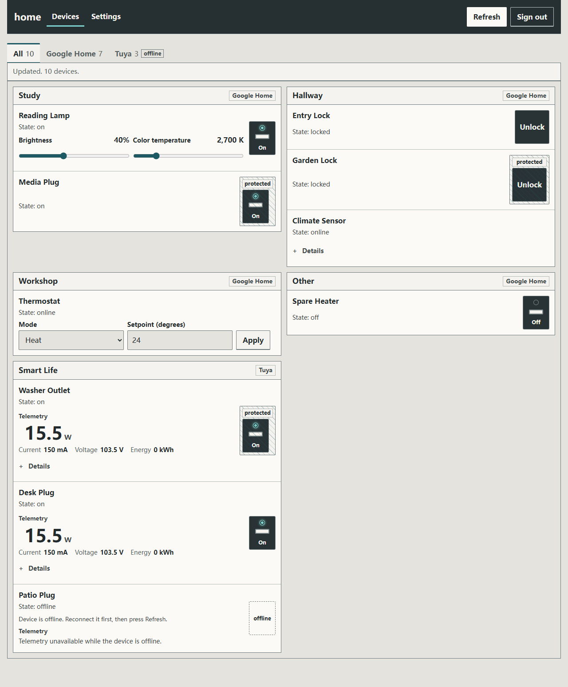
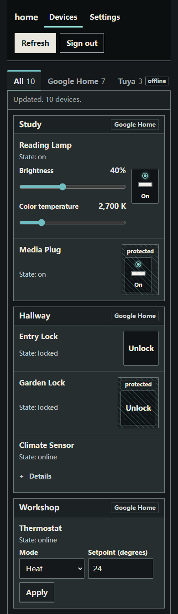

<div align="center">


# home

Google Home と Tuya のデバイスを、1 つの Rust バイナリと Web パネルで操作
します。各コマンドは JSON を 1 つ stdout に書き出し、終了コードが結果を表します。

[](https://github.com/wray-lee/smarthome/actions/workflows/ci.yml) [](LICENSE) [](https://github.com/wray-lee/smarthome/pkgs/container/smarthome) [](Cargo.toml)

[English](README.md) | [简体中文](README.zh-CN.md) | 日本語

[クイックスタート](#quick-start)|[主な機能](#features)|[CLI](#cli)|[マニュアル](#manual)|[安全](#safety)

</div>

<div align="center">

&emsp;

</div>

<a id='features'></a>
## 主な機能

- **独立した 2 つのバックエンド**: Google Home は非公式の foyer API 経由、
  Tuya は Smart Life の QR サインイン経由で接続します。
- **1 コマンド 1 JSON**: `{"ok":true,"data":...}` または
  `{"ok":false,"error":...}` を出力し、終了コードは `0/2/3/4/5/6/7` です。
- **エージェント向け**: CLI は Web パネルと同じコマンド層と安全規則で動きます。
- **ビルド不要の単一ページ**: All、Google Home、Tuya の 3 タブ、UI 3 言語、
  読み取り専用デバイスの `protected` ラベルを備えます。
- **ローカルキーのバックアップとテレメトリー**: `home tuya keys` はデバイス
  ごとの秘密を書き出し、テレメトリーは電力、電流、電圧、累積エネルギーを
  報告します。

<a id='cli'></a>
## コマンドライン

`home gh devices` は Google Home のすべてのデバイスを 1 つの JSON
ドキュメントとして出力します:

```console
$ home gh devices
{
  "ok": true,
  "data": [
    {
      "id": "{device_id}",
      "name": "Desk Plug",
      "room": "Study",
      "kind": "action.devices.types.OUTLET",
      "traits": ["action.devices.traits.OnOff"],
      "backend": "google_home"
    }
  ]
}
$ echo $?
0
```

終了コードは `0` が成功、`2` が使用法の誤り、`3` が名前の曖昧さ、`4` が
デバイスのオフライン、`5` が `reauth_required`、`6` が拒否（機微な操作
または保護デバイス）、`7` が上流のエラーです。[マニュアルの終了コード表](docs/manual/ja.md#exit-codes)
には、パネルの HTTP 対応も載っています。

<a id='quick-start'></a>
## クイックスタート

1. パネルのパスワードをモード 600 のファイルに書き、コンテナをループバックで
   起動します。`HOME_PASSWORD` がなければ `home serve` は起動しません。

```console
printf '%s\n' "HOME_PASSWORD='{panel_password}'" > .env
chmod 600 .env
docker run -d --name home --env-file .env -p 127.0.0.1:8080:8080 \
  -v home-data:/data ghcr.io/wray-lee/smarthome:0.3.0
```

2. コンテナ内で両方のバックエンドに 1 回ずつサインインします:

```console
docker exec -it home home gh login --email you@example.com
docker exec -it home home tuya login
```

3. http://127.0.0.1:8080 を開き、同じパスワードでサインインします。

4. 既定では何も保護されていません。最初の書き込みの前に、読み取り専用に保つ
   デバイスをすべて追加してください。保護を解除できるのは
   `home protect --remove` だけです。コマンドと Compose ファイルは以下にあります。

<details>
<summary>Compose ファイルを使う場合</summary>

`.env` の隣に `compose.yaml` を書き、`docker compose up -d` を実行します。
`${HOME_PASSWORD:?set HOME_PASSWORD}` の形式により、変数が未設定なら
Compose は停止します。

```yaml
services:
  home:
    image: ghcr.io/wray-lee/smarthome:0.3.0
    container_name: home
    ports:
      - "127.0.0.1:8080:8080"
    environment:
      HOME_PASSWORD: ${HOME_PASSWORD:?set HOME_PASSWORD}
    volumes:
      - home-data:/data
    restart: unless-stopped

volumes:
  home-data:
    name: home-data
```

マニュアルの[クイックスタート](docs/manual/ja.md#quick-start)では、パスワード
ファイル、Google の非対話サインイン 2 通り、ヘルスチェックを扱っています。

</details>

<details>
<summary>デバイスを保護する</summary>

```console
docker exec -i home home protect tuya:{device_id}
docker exec -i home home protect gh:{device_id}
```

保護デバイスは、`home protect --remove` を実行するまで、どのバックエンド
からも読み取り専用です。CLI の `--force` とパネルでのパスワード再入力は、
キーボードの前にいる人間のための 1 回限りの上書きであり、エージェント向け
ではありません。[保護デバイス](docs/manual/ja.md#protected-devices)の節に
規則があります。

</details>

<a id='manual'></a>
## ドキュメント

マニュアルは英語、簡体字中国語、日本語で提供しています:
[English](docs/manual/en.md#contents) | [简体中文](docs/manual/zh-CN.md#contents) | [日本語](docs/manual/ja.md#contents)。

- [クイックスタート](docs/manual/ja.md#quick-start)と [Web パネル](docs/manual/ja.md#web-panel)
- [Google Home のデバイス](docs/manual/ja.md#google-home-devices)と [Tuya のサインイン](docs/manual/ja.md#tuya-sign-in)
- [テレメトリー](docs/manual/ja.md#telemetry)と [終了コード](docs/manual/ja.md#exit-codes)
- [保護デバイス](docs/manual/ja.md#protected-devices)と [セキュリティ](docs/manual/ja.md#security)

<a id='safety'></a>
## 安全

- 保護デバイスは、`home protect --remove` を実行するまで、どのバックエンド
  からも読み取り専用です。既定では何も保護されていないため、書き込んでは
  ならないデバイスは明示的に保護する必要があります。
- パネルはループバックにバインドし、Tailscale などのプライベートネットワーク
  経由でアクセスしてください。インターネットには公開しないでください。TLS 終端の
  リバースプロキシを前段に置く場合は、`HOME_COOKIE_SECURE=true` を設定します。
- SQLite データベースは家全体と Google アカウントの鍵であり、
  `home tuya keys` はローカルキーを書き出します。どちらも git に含めず、
  意図的にバックアップしてください。

<a id='license'></a>
## ライセンス

MIT、著作権 2026 wray-lee。全文は [LICENSE](LICENSE) にあります。
`crates/ghome-backend` は
[piekstra/google-home-cli](https://github.com/piekstra/google-home-cli) v0.10.0
のフォークで、`crates/tuya-backend` は `lueur` の `tuya_cloud.rs` を移植して
います。上流の両プロジェクトは MIT です。その全文は
[THIRD_PARTY_NOTICES.md](THIRD_PARTY_NOTICES.md) に収録されています。
