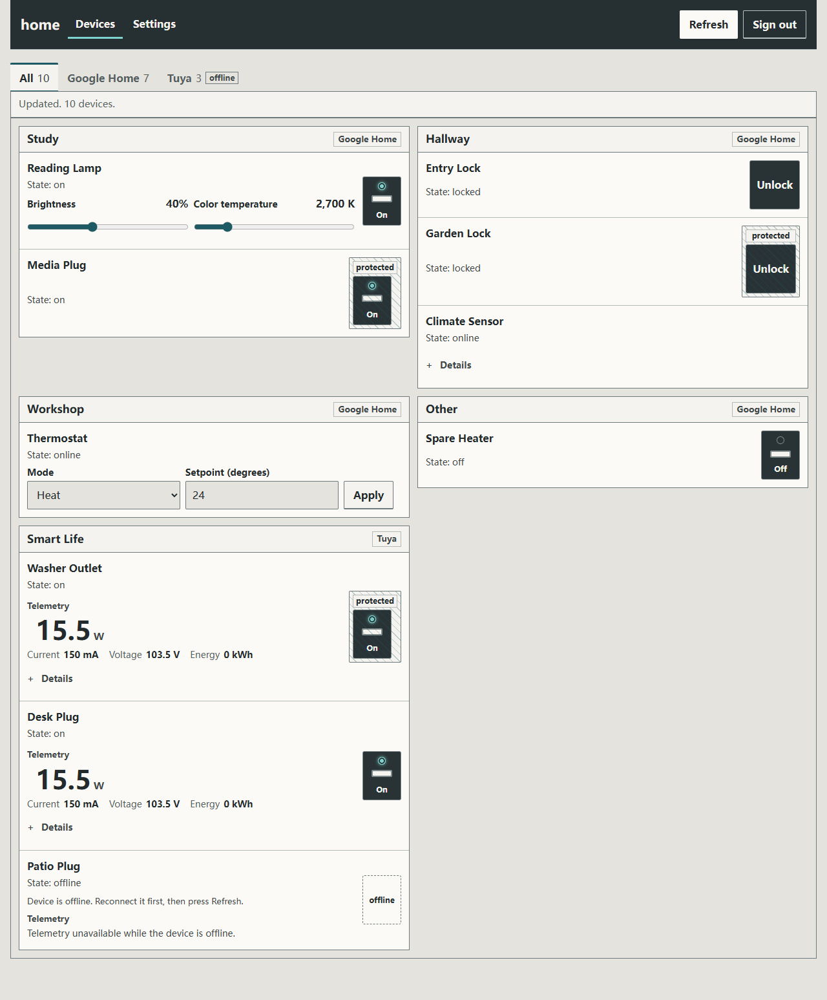
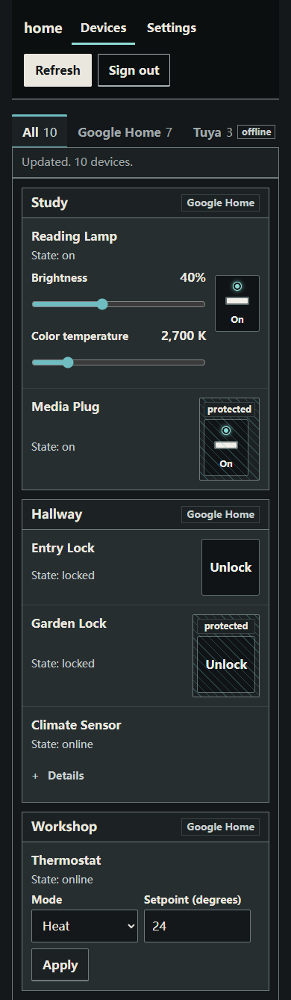

<div align="center">


# home

Google Home and Tuya devices behind one Rust binary and a Web Panel. Every
command prints one JSON document to stdout; the exit code says what happened.

[](https://github.com/wray-lee/smarthome/actions/workflows/ci.yml) [](LICENSE) [](https://github.com/wray-lee/smarthome/pkgs/container/smarthome) [](Cargo.toml)

English | [简体中文](README.zh-CN.md) | [日本語](README.ja.md)

[Quick start](#quick-start) | [Features](#features) | [CLI](#cli) | [Manual](#manual) | [Safety](#safety)

</div>

<div align="center">

&emsp;

</div>

<a id='features'></a>
## Features

- **Two independent Backends**: Google Home through the unofficial foyer API, Tuya through Smart Life QR sign-in.
- **One JSON document per command**: `{"ok":true,"data":...}` or `{"ok":false,"error":...}`, with exit codes `0/2/3/4/5/6/7`.
- **Built for agents**: the CLI runs the same command layer and safety rules as the Web Panel.
- **Zero-build single page**: All, Google Home and Tuya tabs, three UI languages, and a `protected` label on read-only Devices.
- **Local Key backup and Telemetry**: `home tuya keys` exports the per-device secrets; Telemetry reports power, current, voltage and energy.

<a id='cli'></a>
## Command line

`home gh devices` prints every Google Home Device as one JSON document:

```console
$ home gh devices
{
  "ok": true,
  "data": [
    {
      "id": "{device_id}",
      "name": "Desk Plug",
      "room": "Study",
      "kind": "action.devices.types.OUTLET",
      "traits": ["action.devices.traits.OnOff"],
      "backend": "google_home"
    }
  ]
}
$ echo $?
0
```

Exit codes: `0` ok, `2` usage, `3` ambiguous name, `4` Device offline,
`5` `reauth_required`, `6` refused (Sensitive Action or Protected Device),
`7` upstream. The [manual exit-code table](docs/manual/en.md#exit-codes) adds
the panel's HTTP mapping.

<a id='quick-start'></a>
## Quick start

1. Write the panel password to a mode 600 file, then start the container on
   loopback. `HOME_PASSWORD` is required; `home serve` refuses to start
   without one.

```console
printf '%s\n' "HOME_PASSWORD='{panel_password}'" > .env
chmod 600 .env
docker run -d --name home --env-file .env -p 127.0.0.1:8080:8080 \
  -v home-data:/data ghcr.io/wray-lee/smarthome:0.3.1
```

2. Sign both Backends in once inside the container:

```console
docker exec -it home home gh login --email you@example.com
docker exec -it home home tuya login
```

3. Open http://127.0.0.1:8080 and sign in with the same password.

4. Nothing is protected by default. Add every Device that must stay read-only
   before the first write; only `home protect --remove` takes the protection
   away. Both commands and the Compose file are below.

<details>
<summary>Compose file instead</summary>

Write `compose.yaml` next to your `.env` and run `docker compose up -d`. The
`${HOME_PASSWORD:?set HOME_PASSWORD}` form makes Compose stop when the
variable is unset.

```yaml
services:
  home:
    image: ghcr.io/wray-lee/smarthome:0.3.1
    container_name: home
    ports:
      - "127.0.0.1:8080:8080"
    environment:
      HOME_PASSWORD: ${HOME_PASSWORD:?set HOME_PASSWORD}
    volumes:
      - home-data:/data
    restart: unless-stopped

volumes:
  home-data:
    name: home-data
```

The [manual quick start](docs/manual/en.md#quick-start) covers the password
file, both non-interactive Google sign-in fallbacks and the health checks.

</details>

<details>
<summary>Protect a Device</summary>

```console
docker exec -i home home protect tuya:{device_id}
docker exec -i home home protect gh:{device_id}
```

A Protected Device is read-only through every Backend until
`home protect --remove`. `--force` on the CLI and the panel password re-entry
are one-write overrides for the human at the keyboard, never for agents. The
[Protected Devices](docs/manual/en.md#protected-devices) section has the
rules.

</details>

<a id='manual'></a>
## Documentation

The manual ships in English, Simplified Chinese and Japanese:
[English](docs/manual/en.md#contents) | [简体中文](docs/manual/zh-CN.md#contents) | [日本語](docs/manual/ja.md#contents).

- [Quick start](docs/manual/en.md#quick-start) and [Web Panel](docs/manual/en.md#web-panel)
- [Google Home Devices](docs/manual/en.md#google-home-devices) and [Tuya sign-in](docs/manual/en.md#tuya-sign-in)
- [Telemetry](docs/manual/en.md#telemetry) and [exit codes](docs/manual/en.md#exit-codes)
- [Protected Devices](docs/manual/en.md#protected-devices) and [security](docs/manual/en.md#security)

<a id='safety'></a>
## Safety

- A Protected Device is read-only through every Backend until
  `home protect --remove`. Nothing is protected by default; every Device that
  must not be written needs explicit protection.
- Bind the panel to loopback and reach it over Tailscale or another private
  network. Never expose it to the internet; set `HOME_COOKIE_SECURE=true` when
  a TLS reverse proxy is in front.
- The SQLite database is the key to the whole home and the Google account,
  and `home tuya keys` exports the Local Keys. Keep both out of git and back
  them up deliberately.

<a id='license'></a>
## License

MIT, copyright 2026 wray-lee; the full text is in [LICENSE](LICENSE).
`crates/ghome-backend` is a fork of
[piekstra/google-home-cli](https://github.com/piekstra/google-home-cli) v0.10.0,
and `crates/tuya-backend` ports `lueur`'s `tuya_cloud.rs`; both upstream
projects are MIT. Their texts are reproduced in full in
[THIRD_PARTY_NOTICES.md](THIRD_PARTY_NOTICES.md).
