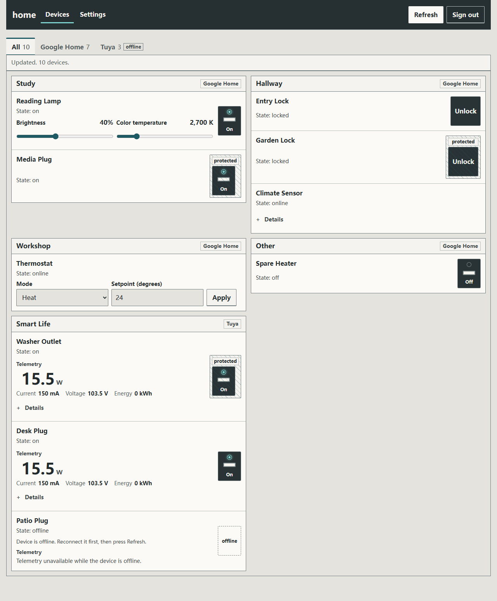
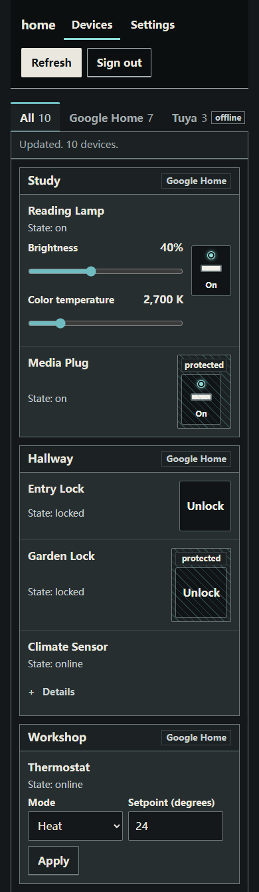

<div align="center">


# home

Google Home 与 Tuya 设备，由一个静态链接（musl）的 Rust 二进制程序和一个网页面板
统一管理。每条命令都向 stdout 输出一份 JSON 文档，退出码说明执行结果。

[](https://github.com/wray-lee/smarthome/actions/workflows/ci.yml) [](LICENSE) [](https://github.com/wray-lee/smarthome/pkgs/container/smarthome) [](Cargo.toml)

[English](README.md) | 简体中文 | [日本語](README.ja.md)

[快速开始](#quick-start) | [功能](#features) | [命令行](#cli) | [手册](#manual) | [安全](#safety)

</div>

<div align="center">

&emsp;

</div>

<a id='features'></a>
## 功能

- **两个独立的后端**：Google Home 通过非官方 foyer API，Tuya 通过 Smart Life 扫码登录。
- **每条命令一份 JSON 文档**：`{"ok":true,"data":...}` 或 `{"ok":false,"error":...}`，退出码为 `0/2/3/4/5/6/7`。
- **为智能体而设计**：CLI 和网页面板共用同一套命令层与安全规则。
- **零构建单页面板**：全部、Google Home 和 Tuya 三个标签页，三种界面语言，只读设备带 `protected` 标签。
- **本地密钥备份与遥测**：`home tuya keys` 导出每台设备的密钥；遥测报告功率、电流、电压和累计电量。

<a id='cli'></a>
## 命令行

`home gh devices` 用一份 JSON 文档列出每台 Google Home 设备：

```console
$ home gh devices
{
  "ok": true,
  "data": [
    {
      "id": "{device_id}",
      "name": "Desk Plug",
      "room": "Study",
      "kind": "action.devices.types.OUTLET",
      "traits": ["action.devices.traits.OnOff"],
      "backend": "google_home"
    }
  ]
}
$ echo $?
0
```

退出码：`0` 成功，`2` 用法错误，`3` 名称歧义，`4` 设备离线，
`5` 需要重新认证（`reauth_required`），`6` 拒绝（敏感操作或受保护设备），
`7` 上游错误。[手册的退出码表](docs/manual/zh-CN.md#exit-codes)还给出
面板的 HTTP 映射。

<a id='quick-start'></a>
## 快速开始

1. 把面板密码写进一个权限为 600 的文件，然后在回环地址上启动容器。
   `HOME_PASSWORD` 是必填项；没有它，`home serve` 会拒绝启动。

```console
printf '%s\n' "HOME_PASSWORD='{panel_password}'" > .env
chmod 600 .env
docker run -d --name home --env-file .env -p 127.0.0.1:8080:8080 \
  -v home-data:/data ghcr.io/wray-lee/smarthome:0.3.0
```

2. 在容器里把两个后端各登录一次：

```console
docker exec -it home home gh login --email you@example.com
docker exec -it home home tuya login
```

3. 打开 http://127.0.0.1:8080，用同一个密码登录。

4. 默认没有设备受保护。首次写入之前，把每台必须保持只读的设备加入保护；
   只有 `home protect --remove` 能解除保护。相关命令和 Compose 文件都在下面。

<details>
<summary>改用 Compose 文件</summary>

把 `compose.yaml` 写在 `.env` 旁边，然后运行 `docker compose up -d`。
`${HOME_PASSWORD:?set HOME_PASSWORD}` 这种写法会让 Compose 在变量未设置时停下。

```yaml
services:
  home:
    image: ghcr.io/wray-lee/smarthome:0.3.0
    container_name: home
    ports:
      - "127.0.0.1:8080:8080"
    environment:
      HOME_PASSWORD: ${HOME_PASSWORD:?set HOME_PASSWORD}
    volumes:
      - home-data:/data
    restart: unless-stopped

volumes:
  home-data:
    name: home-data
```

[手册快速开始](docs/manual/zh-CN.md#quick-start)涵盖密码文件、两种非交互式
Google 登录回退和健康检查。

</details>

<details>
<summary>保护设备</summary>

```console
docker exec -i home home protect tuya:{device_id}
docker exec -i home home protect gh:{device_id}
```

受保护设备经任何后端都只读，直到执行 `home protect --remove`。命令行上的
`--force` 和面板的密码重输是一次性写入覆盖，只留给坐在键盘前的人，绝不适用于
智能体。[受保护设备](docs/manual/zh-CN.md#protected-devices)一节给出完整规则。

</details>

<a id='manual'></a>
## 文档

手册有英语、简体中文和日语三个版本：
[English](docs/manual/en.md#contents) | [简体中文](docs/manual/zh-CN.md#contents) | [日本語](docs/manual/ja.md#contents)。

- [快速开始](docs/manual/zh-CN.md#quick-start)和[网页面板](docs/manual/zh-CN.md#web-panel)
- [Google Home 设备](docs/manual/zh-CN.md#google-home-devices)和[Tuya 登录](docs/manual/zh-CN.md#tuya-sign-in)
- [遥测](docs/manual/zh-CN.md#telemetry)和[退出码](docs/manual/zh-CN.md#exit-codes)
- [受保护设备](docs/manual/zh-CN.md#protected-devices)和[安全](docs/manual/zh-CN.md#security)

<a id='safety'></a>
## 安全

- 受保护设备经任何后端都只读，直到执行 `home protect --remove`。默认没有
  设备受保护；每台不允许写入的设备都需要显式保护。
- 把面板绑定到回环地址，通过 Tailscale 或其他私有网络访问。绝不要把它
  暴露到互联网；如果前面有 TLS 反向代理，设置 `HOME_COOKIE_SECURE=true`。
- SQLite 数据库是整个家庭和 Google 账号的总钥匙，`home tuya keys` 会导出
  本地密钥。两者都要留在 git 之外，并单独备份。

<a id='license'></a>
## 许可证

MIT，版权所有 2026 wray-lee；完整文本见 [LICENSE](LICENSE)。
`crates/ghome-backend` 分叉自
[piekstra/google-home-cli](https://github.com/piekstra/google-home-cli) v0.10.0，
`crates/tuya-backend` 移植了 `lueur` 的 `tuya_cloud.rs`；两个上游项目均为 MIT。
它们的许可证全文收录在
[THIRD_PARTY_NOTICES.md](THIRD_PARTY_NOTICES.md)。